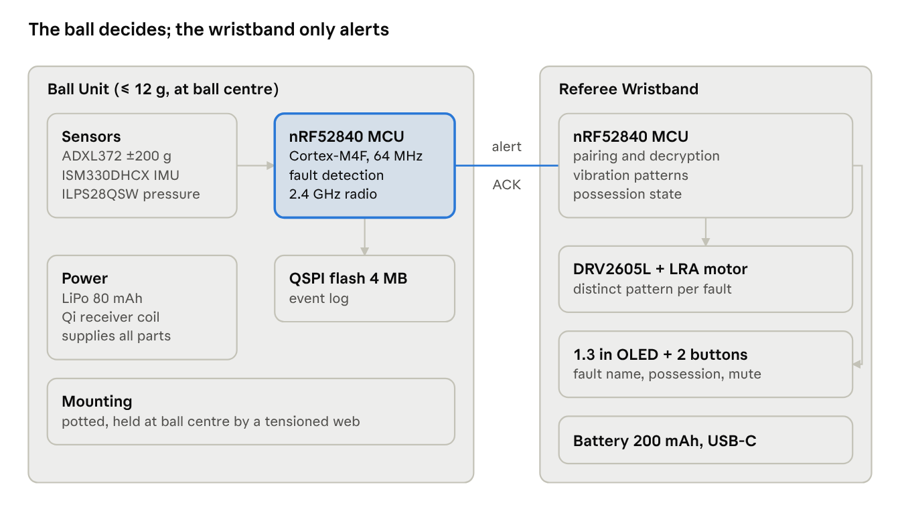
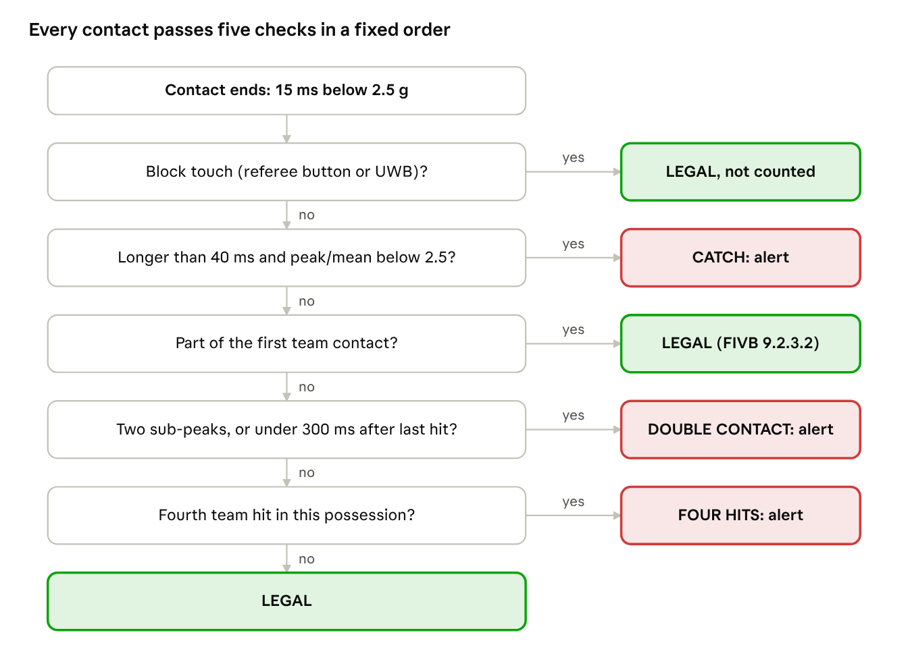

# Smart Volleyball Fault Detector

A sensor chip sealed at the centre of a volleyball detects ball-handling faults
(double contact, catch/carry, four hits) and vibrates the referee's wristband
within 150 ms of the contact.

This repository holds the Python reference model of the ball firmware's
detection logic. It is the executable specification the C firmware
(nRF52840, Zephyr) must match.

| File | Contents |
| --- | --- |
| `detector.py` | Contact segmentation, feature extraction, FIVB rule engine |
| `simulator.py` | Synthetic accelerometer signals (hits, sets, catches, doubles) |
| `radio.py` | Alert packet format, AES-128-CCM link, retries |
| `test_detector.py` | Software test cases STC-01 to STC-16 |
| `test_results.txt` | Latest test run (16/16 passed, simulated data) |
| `docs/` | Hardware architecture and rule-engine diagrams |

## Run the tests

```bash
pip install -r requirements.txt
python -m pytest -v            # MC_N=30000 for the full Monte Carlo run
```

## Status

- Software: 16/16 tests pass on **simulated** signals. Results must be
  repeated on real recorded contacts (hardware test HTC-08).
- Open risk: slow legal sets (40-55 ms) are flagged as CATCH 53 % of the time
  in simulation; the catch threshold needs real data.
- Hardware: no prototype yet; all hardware tests are "Not run".



